# MyFreecell Gameplay/Domain Specification

Status: Approved
Scope: Version one
Governing product document: `docs/product/product-spec.md` (Approved)

## 1. Purpose and Authority

- **GD-SCOPE-01** This document is authoritative for the deterministic FreeCell rules and domain state transitions of MyFreecell version one, as delegated by product-spec PLAY-09, UNDO-07, TIME-10, and Section 19.
- **GD-SCOPE-02** This document is subordinate to the player-facing outcomes of the product specification. Where a rule here would contradict a product-specification outcome, the product specification governs and this document must be revised.
- **GD-SCOPE-03** This document defines: cards; deal identity and the initial layout; game-state components; movement legality; sequence validity; movement capacity; how rejections are classified; single-tap destination selection; foundation legality; safe automatic foundation movement and cascade order; move counting; Undo and Redo grouping; lifecycle transitions; completion; invariants; and which states are eligible for persistence.
- **GD-SCOPE-04** This document must not define screens, navigation, layout, styling, animation timing, sound, user-facing copy (except the PLAY-10 values M and N), settings or statistics presentation, timer measurement, implementation technology, deal-identity generation mechanics, storage format, storage timing, transaction or recovery mechanisms, or code organization.
- **GD-SCOPE-05** Every rule in this document must be deterministic: the same domain state and the same request must always produce the same outcome.

## 2. Normative Language

- "must" identifies required behavior.
- "must not" identifies prohibited behavior.
- "should" identifies a deliberate recommendation.
- "may" identifies genuinely optional behavior.

Requirement identifiers in the form `GD-XXX-NN` are stable references for review, testing, and later specifications. They do not change when section numbers change. Product-specification identifiers (for example `PLAY-10`) refer to `docs/product/product-spec.md`.

The capitalized term "Restart" refers only to the lifecycle operation Restart This Deal (Section 17.2). Repetition of the automatic scan is described as the scan beginning again from FC1 (GD-AUTO-07).

## 3. Terminology

- **GD-TERM-01** Standard FreeCell terminology is primary. The aliases are retained for reference only:
  - **Free cells** (alias **Area A**): four single-card holding positions, FC1 to FC4, numbered left to right.
  - **Foundations** (alias **Area B**): four suit piles, F1 to F4, numbered left to right (GD-FND-01).
  - **Tableau** (alias **Area C**): eight columns, T1 to T8, numbered left to right.
- **GD-TERM-02** **Position**: one free cell, one foundation slot, or one tableau column.
- **GD-TERM-03** **Tableau order**: the cards of a tableau column are ordered from the first card placed (the deepest card, shown visually uppermost) to the last card placed (shown visually bottommost). "Below" a card means later in tableau order.
- **GD-TERM-04** **Exposed card**:
  - the bottommost (last) card of a nonempty tableau column; or
  - the card in an occupied free cell.

  Foundation cards are never exposed for the purposes of this document.
- **GD-TERM-05** **Covered card**: a tableau card that is not the exposed card of its column.
- **GD-TERM-06** **Tail**: a touched tableau card together with every card below it in the same column.
- **GD-TERM-07** **Head**: the first card of a tail. This is the touched card, and the highest-ranked card of a valid sequence.
- **GD-TERM-08** **Transfer**: the relocation of one card or one tail from one position to another, applied to the authoritative domain state.
- **GD-TERM-09** **Deliberate transfer**: a transfer requested by the player through a drag or a single tap.
- **GD-TERM-10** **Automatic transfer**: a transfer to a foundation made by the domain under Section 13.
- **GD-TERM-11** **Cascade**: the ordered series of automatic transfers produced by one automatic evaluation (Section 14).
- **GD-TERM-12** **Compound turn**: one deliberate transfer followed by its complete cascade (GD-HIST-01).
- **GD-TERM-13** **Stable state**: a domain state in which no transfer or cascade is in progress and no exposed card is safe (GD-INV-06). This is the domain counterpart of the product-specification "stable point".
- **GD-TERM-14** **Foundation level**: the number of cards in a foundation slot, from 0 to 13.
- **GD-TERM-15** **Notation** used in this document:
  - A card is written as rank followed by suit letter, for example `10H`, `QS`, `AC`.
  - A tableau column is listed in tableau order, exposed card last. For example, `T3: KH, AD, 9S` means `9S` is exposed.
  - "..." stands for cards that are irrelevant to the example.
  - D1, D2 denote deal identities.

## 4. Cards

- **GD-CARD-01** The deck must contain exactly 52 unique cards: one of each combination of 13 ranks and 4 suits.
- **GD-CARD-02** Ranks, with their numeric values, are: Ace (A) 1, 2 to 10 at face value, Jack (J) 11, Queen (Q) 12, King (K) 13.
- **GD-CARD-03** Suits are Clubs (C), Diamonds (D), Hearts (H), and Spades (S).
- **GD-CARD-04** Clubs and Spades are black. Diamonds and Hearts are red.
- **GD-CARD-05** Two cards have alternating colors when one is red and the other is black.

## 5. Deal Identity and Initial Layout

- **GD-DEAL-01** A **deal identity** is an internal value from which one initial arrangement is reproduced. Its representation is defined by architecture. It must never be shown to or chosen by the player (product PERS-08).
- **GD-DEAL-02** The domain requires a deterministic deal function that maps a deal identity to exactly one permutation P = (p1, p2, ..., p52) of the 52-card deck. Every card must appear exactly once in P.
- **GD-DEAL-03** For a fixed approved shuffle-function version, the same deal identity must always produce the same permutation. Reliable reproduction of a deal therefore depends on two values: the deal identity and the shuffle-function version. Neither must be shown to the player.
- **GD-DEAL-04** Architecture selects, documents, and versions:
  - the exact pseudo-random number generator;
  - the seed representation;
  - the deterministic shuffle procedure;
  - the mechanism that generates new deal identities.

  This document does not select an algorithm or a storage mechanism.
- **GD-DEAL-05** Changing the shuffle-function version after release may change the permutation produced by an existing deal identity. This can affect a saved unfinished game and product-spec LIFE-13. Any such change requires deliberate compatibility or migration consideration.
- **GD-DEAL-06** The initial layout must be produced from P as follows:
  - all free cells empty;
  - all foundations at level 0;
  - card p_i dealt, for i from 1 to 52 in order, to tableau column T((i - 1) mod 8 + 1), each card becoming that column's new exposed card.
- **GD-DEAL-07** As a consequence of GD-DEAL-06, columns T1 to T4 receive seven cards each and columns T5 to T8 receive six cards each. The exposed cards of the initial layout are p49, p50, p51, p52 (T1 to T4) and p45, p46, p47, p48 (T5 to T8).
- **GD-DEAL-08** Initial automatic foundation evaluation (GD-AUTO-04) must begin only after the complete initial layout has been produced.
- **GD-DEAL-09** New Game must use a newly generated deal identity that differs from the identity of the deal being replaced or most recently completed. The identity need not be globally unique across all historical deals. This document does not require its resulting arrangement to differ visibly from any earlier arrangement. A visibly repeated arrangement is not a product failure. GD-LIFE-01 defines how the domain enforces this rule.
- **GD-DEAL-10** Restart This Deal must reuse the current deal identity and its shuffle-function version.
- **GD-DEAL-11** Version one must not run a solver before presenting a deal, and does not guarantee that a deal is solvable.
- **GD-DEAL-12** Version one does not require compatibility with any external deal-numbering scheme.

## 6. Game-State Components

- **GD-STATE-01** A domain game state consists of:
  1. the deal identity, interpreted under its shuffle-function version (GD-DEAL-03);
  2. the board: FC1 to FC4, each empty or holding one card; F1 to F4, each with a foundation level; T1 to T8, each an ordered list of cards in tableau order;
  3. the move count, a non-negative integer;
  4. the status: **In progress** or **Completed**;
  5. the history: an ordered list of compound-turn entries plus a cursor (Section 16).
- **GD-STATE-02** Foundation slots are permanently assigned to suits as defined by GD-FND-01. A slot must never acquire a suit dynamically.
- **GD-STATE-03** A foundation at level k holds the Ace through rank k of its assigned suit, in ascending order. Its top card is rank k, or there is no card when k is 0.
- **GD-STATE-04** Elapsed active-play time is measured and owned by the product layer. The domain must not measure, store, or report elapsed time. This document states only the product-layer obligations that relate to domain transitions:
  - the product layer resets elapsed time on New Deal (GD-LIFE-03) and on Restart (GD-LIFE-05);
  - Undo and Redo do not rewind it (GD-HIST-08);
  - the product layer samples its timer when it receives a completion outcome (GD-CMP-03).
- **GD-STATE-05** The initial move count of a deal is not a separate stored component. It is reproduced deterministically by GD-LIFE-02 or GD-LIFE-05.
- **GD-STATE-06** Every domain request must produce a **transition outcome** containing:
  - exactly one classification:
    - New Deal: **Accepted** when successfully initialized (GD-LIFE-02); **Invalid** when the supplied identity equals the current deal identity (GD-LIFE-01).
    - Restart: **Accepted** when successfully applied (GD-LIFE-05); **Unavailable** when Restart is not allowed, including when the status is Completed (GD-LIFE-05).
    - Restore: **Accepted** when the candidate is restorable (GD-LIFE-07); **not restorable** when validation fails (GD-LIFE-08).
    - Drag: **Accepted**, **Silent rejection**, or **Capacity rejection** (GD-REJ-01).
    - Tap: **Accepted** or **No move** (GD-TAP-01).
    - Undo: **Accepted** when successfully applied (GD-HIST-06); **Unavailable** otherwise (GD-HIST-09).
    - Redo: **Accepted** when successfully applied (GD-HIST-07); **Unavailable** otherwise (GD-HIST-09).
  - the resulting state;
  - the ordered list of transfers applied, which may be empty;
  - for a capacity rejection only, the values M and N;
  - a completion indicator. It is true only for the transition that contains the completing transfer. In that case the outcome must also report the final domain move count, and the completing transfer must be the last transfer in the ordered list (GD-CMP-05).

  These classifications do not change move counting (Section 15), timer ownership (GD-STATE-04), persistence eligibility (Section 20), or movement legality.
  **Invalid**, **Unavailable**, **not restorable**, **Silent rejection**, **Capacity rejection**, and **No move** leave the domain state unchanged.
  An **Accepted** Undo and an **Accepted** Redo return the resulting state and the ordered transfers defined by GD-HIST-06 and GD-HIST-07.
  An **Accepted** Restart returns the stable state after the initial cascade (GD-LIFE-05).
  An **Accepted** Restore returns the adopted stable In-progress state with empty history (GD-LIFE-07).
  A transition outcome must not contain an elapsed-time value.
- **GD-STATE-07** The domain accepts these requests: New Deal, Restart, Restore, Drag, Tap, Undo, Redo.
- **GD-STATE-08** Request contents:
  - A **New Deal** request consists of a newly generated deal identity and its shuffle-function version.
  - A **Drag** request consists of a source and a destination:
    - **source**: a free cell, or a tableau column plus the touched card;
    - **destination**: a free cell, a foundation slot, a tableau column, or none.
  - A **Tap** request consists of the tapped position and, when one is present, the tapped card.

## 7. Legal Sources and Destinations

- **GD-MOVE-01** Legal drag sources are:
  - an occupied free cell (the transfer contains exactly its one card);
  - any card of a nonempty tableau column (the transfer contains that card's complete tail).
- **GD-MOVE-02** Foundations are destination-only (GD-FND-01). A foundation card must never be the source of a deliberate transfer. Only Undo and Redo may remove a card from a foundation or reapply a foundation transfer (GD-HIST-06, GD-HIST-07).
- **GD-MOVE-03** The attempted cards of a tableau drag are exactly the touched card and every card below it. The count of these cards is M.
- **GD-MOVE-04** The domain must never substitute a shorter tail, a longer tail, or any other subset for the attempted cards.
- **GD-MOVE-05** A free cell is a legal destination only when all of the following hold:
  - it is empty;
  - M = 1;
  - the source is a tableau column.
- **GD-MOVE-06** A foundation slot is a legal destination only when M = 1 and the card satisfies GD-FND-02.
- **GD-MOVE-07** A nonempty tableau column other than the source is a legal destination only when all of the following hold:
  - the attempted cards form a valid sequence (Section 8);
  - the head is exactly one rank lower than the destination's exposed card;
  - the head and the destination's exposed card have alternating colors;
  - M does not exceed the movement capacity (Section 9).
- **GD-MOVE-08** An empty tableau column is a legal destination for a single card or for a valid sequence, provided M does not exceed the movement capacity computed with that destination excluded (GD-CAP-03).
- **GD-MOVE-09** The following are always illegal:
  - a destination equal to the source position;
  - a free-cell-to-free-cell transfer;
  - a drag with no destination.
- **GD-MOVE-10** Source and destination summary:

| Source | Destination | Legal when |
|---|---|---|
| Tableau, M = 1 | Empty free cell | Always |
| Tableau, M > 1 | Free cell | Never |
| Tableau, M = 1 | Foundation slot | GD-FND-02 |
| Tableau, M > 1 | Foundation slot | Never |
| Tableau | Other nonempty tableau column | GD-MOVE-07 |
| Tableau | Empty tableau column | GD-MOVE-08 |
| Tableau | Its own column | Never (no-op) |
| Free cell | Any free cell | Never (same cell or other cell) |
| Free cell | Foundation slot | GD-FND-02 |
| Free cell | Nonempty tableau column | GD-MOVE-07 with M = 1 |
| Free cell | Empty tableau column | Always |
| Foundation | Anything | Never |
| Empty position | Anything | Never |
| Any | None | Never |

## 8. Tableau Sequence Validity

- **GD-SEQ-01** A list of one card is a valid sequence.
- **GD-SEQ-02** A list of two or more cards is a valid sequence only when every adjacent pair, taken in tableau order, satisfies both of these:
  - the later card is exactly one rank lower than the earlier card;
  - the two cards have alternating colors.
- **GD-SEQ-03** Validity is evaluated on the complete attempted tail. If any adjacent pair fails, the whole attempt is invalid. GD-MOVE-04 applies: no valid sub-tail is substituted.
- **GD-SEQ-04** A tableau column may contain cards in any order because of the deal. Only sequences being moved are tested for validity.

## 9. Multi-Card Movement Capacity

- **GD-CAP-01** Movement capacity is evaluated on the state before the transfer.
- **GD-CAP-02** Movement capacity = (number of empty free cells) + (number of eligible empty tableau columns) + 1.
- **GD-CAP-03** An eligible empty tableau column is any empty tableau column other than the destination. When the destination is an empty column, it does not count toward capacity.
- **GD-CAP-04** The source column is never empty before the transfer, so it is never an assisting column.
- **GD-CAP-05** For an attempted sequence of M cards, the required number of assisting empty spaces is **N = M - 1**. N is the total required, not the shortfall from current capacity. The product layer uses M and N in the PLAY-10 message. N is always at least 1 in a capacity rejection.
- **GD-CAP-06** Capacity is always at least 1, so a single-card transfer is never rejected for capacity.

## 10. Rejection Classification and Precedence

- **GD-REJ-01** Every Drag request is classified as exactly one of:
  - **Accepted**: the transfer is applied (Section 15 and Section 16 effects apply).
  - **Silent rejection**: no board change, no move-count change, no history change, no gameplay message (product PLAY-03).
  - **Capacity rejection**: no board change, no move-count change, no history change. The outcome carries M and N for product PLAY-10.
- **GD-REJ-02** A Drag request must be evaluated in this order. The first rule that applies determines the classification:
  1. The status is Completed: silent rejection.
  2. The source is a foundation, an empty free cell, or an empty tableau column: silent rejection.
  3. The destination is none: silent rejection.
  4. The destination equals the source position: silent rejection (no-op).
  5. The attempted cards do not form a valid sequence: silent rejection.
  6. The destination is a free cell and any of these hold: M > 1, the cell is occupied, or the source is a free cell. Silent rejection.
  7. The destination is a foundation slot and any of these hold: M > 1, the slot is not assigned to the card's suit, or the card is not the next rank for that slot. Silent rejection.
  8. The destination is a nonempty tableau column and the head does not fit its exposed card under GD-MOVE-07: silent rejection.
  9. M exceeds movement capacity for this destination: capacity rejection with M and N = M - 1.
  10. Otherwise: accepted.
- **GD-REJ-03** A capacity rejection arises only when all of the following hold:
  - the attempted cards are a valid sequence;
  - they form the complete tail starting at the touched card;
  - the destination is a tableau column other than the source;
  - the head fits the destination's exposed card, or the destination is empty;
  - capacity is the only reason the transfer fails.
- **GD-REJ-04** An invalid sequence, an incompatible destination card, a multi-card drop on a free cell or foundation, a drop with no destination, and a drop on the source must each produce a silent rejection, even when M also exceeds capacity.
- **GD-REJ-05** Rejected and no-op requests must leave the domain state, including history, exactly unchanged.

## 11. Single-Tap Behavior

- **GD-TAP-01** A tap is classified as **Accepted** (exactly one card is transferred) or **No move** (no board change, no move-count change, no history change, no gameplay message; product PLAY-05).
- **GD-TAP-02** A tap must be classified as No move when any of these hold:
  - the status is Completed;
  - the tap is on a covered tableau card;
  - the tap is on a foundation card;
  - the tap is on an empty free cell, an empty foundation slot, or an empty tableau column;
  - the tap is on no position.
- **GD-TAP-03** A tap never selects or transfers more than one card.
- **GD-TAP-04** For an exposed tableau card that is not the only card in its column, the destination is the first of these that exists:
  1. its own foundation slot, if GD-FND-02 holds;
  2. the leftmost nonempty tableau column, other than the source, whose exposed card it legally fits (GD-MOVE-07 with M = 1);
  3. the leftmost empty tableau column;
  4. the leftmost empty free cell;
  5. otherwise, No move.
- **GD-TAP-05** For an exposed tableau card that is the only card in its column, the destination is the first of these that exists:
  1. its own foundation slot, if GD-FND-02 holds;
  2. the leftmost nonempty tableau column whose exposed card it legally fits;
  3. otherwise, No move. An empty tableau column and an empty free cell must not be selected.
- **GD-TAP-06** For a card in a free cell, the destination is the first of these that exists:
  1. its own foundation slot, if GD-FND-02 holds;
  2. the leftmost nonempty tableau column whose exposed card it legally fits;
  3. the leftmost empty tableau column;
  4. otherwise, No move. Another free cell is never selected.
- **GD-TAP-07** Any destination that single tap does not select may still be reached by an explicit drag, where Section 7 allows it.

## 12. Foundation Legality

- **GD-FND-01** The four foundation slots are fixed from left to right as F1 Clubs, F2 Hearts, F3 Spades, and F4 Diamonds. Foundations build upward by suit from Ace through King and are destination-only for deliberate player input.
- **GD-FND-02** A card of rank R and suit S may enter a foundation slot only when both hold:
  - the slot is the fixed slot for S (GD-FND-01);
  - that slot's level is R - 1.
- **GD-FND-03** Dropping a card on a slot assigned to a different suit is a silent rejection.
- **GD-FND-04** A deliberate foundation transfer is legal whenever GD-FND-02 holds, even if the card is not safe under GD-AUTO-02. Manual legality is less restrictive than automatic safety.
- **GD-FND-05** Single tap and automatic transfers must always target the fixed slot of the card's suit.

## 13. Safe Automatic Foundation Behavior

- **GD-AUTO-01** Automatic foundation movement must always be on and has no setting (product PLAY-06).
- **GD-AUTO-02** A card of rank R and suit S is **safe** only when all of the following hold:
  1. it is exposed, in a free cell or a tableau column;
  2. the foundation for S is at level R - 1;
  3. every foundation is at level R - 1 or higher.
- **GD-AUTO-03** Consequences of GD-AUTO-02:
  - every exposed Ace is safe;
  - a Two is safe only when all four Aces are on the foundations;
  - a Three is safe only when all four Twos are on the foundations;
  - the pattern continues through King.
- **GD-AUTO-04** Automatic evaluation (Section 14) must run:
  - after the complete initial layout of a new deal;
  - after Restart reproduces the initial layout;
  - after each accepted deliberate transfer;
  - after Redo (GD-HIST-07).
- **GD-AUTO-05** Automatic evaluation must not run:
  - immediately after Undo;
  - after Restore;
  - after any rejection, No move, Unavailable, Invalid, or not-restorable outcome.
- **GD-AUTO-06** Every automatic transfer is a transfer to the card's foundation and counts as one move (GD-CNT-02).

## 14. Deterministic Cascade Ordering

- **GD-AUTO-07** An automatic evaluation must proceed as follows:
  1. Scan FC1, FC2, FC3, FC4, then T1 through T8, in that order.
  2. At the first position whose exposed card is safe, transfer that card to its foundation and increase the move count by 1.
  3. Begin a new scan from FC1.
  4. When a complete scan finds no safe card, the evaluation ends.
- **GD-AUTO-08** Exactly one card is transferred per scan step. The cascade's ordered list of transfers is part of the transition outcome.
- **GD-AUTO-09** A cascade ends after at most 52 transfers.
- **GD-AUTO-10** Given the same starting state, the cascade must be identical: same cards, same order, same move count. This holds in particular for the initial cascade reproduced by Restart.

## 15. Move Counting

- **GD-CNT-01** Each accepted deliberate transfer increases the move count by exactly 1. This covers:
  - a single-card drag;
  - a valid multi-card drag of any length;
  - a successful single tap.
- **GD-CNT-02** Each automatic transfer increases the move count by exactly 1. This includes automatic transfers in the initial cascade and in a cascade reproduced by Restart.
- **GD-CNT-03** These must not change the move count:
  - silent rejections, capacity rejections, and no-ops;
  - taps classified as No move;
  - Unavailable, Invalid, and not-restorable outcomes;
  - Undo and Redo as commands. Undo sets the count back to its recorded earlier value, and Redo sets it forward to its recorded later value (GD-HIST-06, GD-HIST-07);
  - presentation events such as navigation or animation.
- **GD-CNT-04** The move count is reset to 0 only by an accepted New Deal and by Restart, before the initial cascade.
- **GD-CNT-05** The move count of a compound turn increases by 1 plus the number of automatic transfers in its cascade.

## 16. Compound Undo and Redo History

- **GD-HIST-01** An accepted deliberate transfer and the complete cascade it triggers form one indivisible compound turn, applied as one domain transition: stable state before, then the deliberate transfer, then the complete cascade, then the stable state after.
- **GD-HIST-02** Each compound turn creates exactly one history entry, containing:
  - the stable state before the turn, including its move count;
  - the deliberate transfer;
  - the ordered automatic transfers;
  - the stable state after the turn, including its move count.
- **GD-HIST-03** The history cursor marks the entry that Undo will reverse next. Entries after the cursor form the Redo path.
- **GD-HIST-04** A new compound turn must discard the entire Redo path before it is recorded.
- **GD-HIST-05** The initial cascade, whether after New Deal or after Restart, must not create a history entry. These requests leave the history empty:
  - an accepted New Deal;
  - Restart;
  - a restorable Restore.
- **GD-HIST-06** Undo is available only when the status is In progress and an entry exists before the cursor. A successfully applied Undo is classified as **Accepted**. Accepted Undo must:
  - restore that entry's stable state before the turn, including its move count;
  - move the cursor back by one;
  - not run automatic evaluation.

  The Accepted outcome returns that restored stable state and the compound turn's transfers in reverse order, last transfer first.
- **GD-HIST-07** Redo is available only when the status is In progress and an entry exists after the cursor. A successfully applied Redo is classified as **Accepted**. Accepted Redo must:
  - restore that entry's stable state after the turn, including its move count, which is equivalent to reapplying the deliberate transfer and then running automatic evaluation (GD-AUTO-10);
  - move the cursor forward by one.

  The Accepted outcome returns that stable state and the same ordered transfers as the original turn.
- **GD-HIST-08** Undo and Redo provide no elapsed-time value. The product layer must not rewind elapsed active-play time because of Undo or Redo.
- **GD-HIST-09** An Undo or Redo request that cannot be applied, including when the status is Completed or no corresponding history entry exists, must be classified as **Unavailable** and must leave the state unchanged.
- **GD-HIST-10** History is unlimited within the in-memory session (product UNDO-01) and must not be eligible for persistence (product UNDO-03, PERS-04).
- **GD-HIST-11** Every state that Undo restores is a stable state recorded before a compound turn (GD-INV-11). Suppressing automatic evaluation after Undo therefore never leaves a safe card unmoved.

## 17. Lifecycle Transitions

### 17.1 New Deal

- **GD-LIFE-01** New Deal works as follows:
  - **From any status.** The domain may initialize a New Deal from any prior domain status, and also when no current domain state exists.
  - **The identity is supplied.** A New Deal request supplies a newly generated deal identity and its shuffle-function version (GD-STATE-08). Generation mechanics belong to architecture (GD-DEAL-04).
  - **The identity must differ from the current deal.** When a current domain state exists, In progress or Completed, the supplied identity must differ from that state's deal identity. This covers both the deal being replaced and the most recently completed deal (GD-DEAL-09).
  - **A matching identity is Invalid.** A New Deal request whose identity equals the current deal identity must be classified as **Invalid**. An Invalid outcome leaves the state unchanged, runs no automatic evaluation, and changes neither the move count nor the history.
  - **No other identity is compared.** The domain compares the supplied identity only with the current deal identity. It must not track, store, or check identities of older, non-current deals, and such an identity may be reused.
  - **The product layer authorizes replacement.** Authorization to replace an unfinished game belongs to the product layer. Before requesting replacement of an unfinished deal, the product layer must satisfy its confirmation and loss-finalization requirements (product NAV-05, NAV-10, LIFE-05, LIFE-09).
- **GD-LIFE-02** A New Deal that is successfully initialized is classified as **Accepted**. An Accepted New Deal must:
  1. adopt the supplied deal identity and shuffle-function version;
  2. produce the initial layout (GD-DEAL-06);
  3. set the move count to 0;
  4. set the status to In progress;
  5. clear the history;
  6. run automatic evaluation (GD-AUTO-04).

  The resulting move count is the deal's **initial move count**. If the initial cascade completes the deal, Section 18 applies (GD-CMP-07).
- **GD-LIFE-03** On an accepted New Deal, the product layer must start elapsed active-play time at zero (product LIFE-01).
- **GD-LIFE-04** The domain must not record victories or losses. Result finalization belongs to the product layer.

### 17.2 Restart

- **GD-LIFE-05** Restart is available only while the status is In progress. A Restart that is successfully applied is classified as **Accepted**. Accepted Restart must:
  1. reproduce the initial layout from the current deal identity and its shuffle-function version;
  2. set the move count to 0;
  3. clear the history;
  4. run automatic evaluation.

  The Accepted outcome returns the stable state after that initial cascade, including the cascade's ordered transfers. The product layer must reset elapsed active-play time to zero (product LIFE-11). The resulting board and move count must equal those produced by GD-LIFE-02 for the same identity and version (product LIFE-10, LIFE-11, LIFE-13). A Restart request is classified as **Unavailable** when Restart is not allowed, including when the status is Completed and when no In-progress state exists. An Unavailable Restart leaves the state unchanged.
- **GD-LIFE-06** Restart must not complete, finalize, or record a result (product LIFE-04). Restart cannot complete a deal: it replays the same initial cascade, and an initial cascade that completes the deal leaves the status Completed, where Restart is unavailable.

### 17.3 Restore

- **GD-LIFE-07** Restore accepts a candidate state consisting of a deal identity with its shuffle-function version, a board, and a move count. When the candidate is restorable, Restore is classified as **Accepted** and must:
  - adopt the candidate's deal identity, board, and move count;
  - set the status to In progress;
  - set the history to empty;
  - not run automatic evaluation.

  The Accepted outcome returns that adopted stable In-progress state with empty history.
- **GD-LIFE-08** A candidate is restorable only when all of the following hold:
  - it satisfies every invariant in Section 19, including that no exposed card is safe (GD-INV-06);
  - it is not complete;
  - its deal identity can be reproduced under its shuffle-function version, so that Restart remains possible.

  When validation fails, the candidate must be classified as **not restorable**, and the state must not change. The player-facing recovery behavior for a candidate that is not restorable is owned by the product layer under product PERS-07.

### 17.4 Lifecycle summary

```mermaid
stateDiagram-v2
    [*] --> InProgress: New Deal, layout, initial cascade
    [*] --> Completed: New Deal whose initial cascade completes
    InProgress --> InProgress: Accepted compound turn
    InProgress --> InProgress: Rejection or No move, unchanged
    InProgress --> InProgress: Undo or Redo
    InProgress --> InProgress: Restart, layout, initial cascade
    InProgress --> InProgress: New Deal with a different identity
    InProgress --> InProgress: New Deal with the same identity, Invalid, unchanged
    InProgress --> Completed: Transfer brings foundations to 52 cards
    Completed --> InProgress: New Deal with a different identity
    Completed --> Completed: New Deal with the same identity, Invalid, unchanged
```

## 18. Completion

- **GD-CMP-01** A deal is complete when all 52 cards are on the foundations, which means every foundation is at level 13.
- **GD-CMP-02** Completion must be detected immediately after each transfer, whether deliberate or automatic, including transfers in an initial cascade. The transfer that brings the foundation total to 52 is the completing transfer. It is necessarily the last transfer of its transition.
- **GD-CMP-03** Completion occurs when the completing transfer is applied to the authoritative domain state. This is the domain moment at which the last card legally reaches the foundations (product WIN-02).
  - Presentation may still be animating that transfer.
  - Animation duration must not affect the final move count or the final time.
  - The final domain move count is the move count immediately after the completing transfer.
  - The domain does not report elapsed time. The product layer obtains the final time by sampling its active-play timer when it receives the completion outcome (product WIN-02, AC-24).
- **GD-CMP-04** When completion occurs, the status must become Completed. In the Completed status:
  - Drag requests are silent rejections;
  - Tap requests are No move;
  - Undo, Redo, and Restart are Unavailable.

  Only an accepted New Deal changes the state (product WIN-02, UNDO-06).
- **GD-CMP-05** The transition containing the completing transfer must report:
  - completed = true;
  - the final domain move count;
  - the completing transfer as the last transfer in the ordered transfer list.

  Completion must be reported exactly once per deal, on that transition only. A Completed state cannot return to In progress for the same deal. This lets the product layer finalize each result exactly once (product LIFE-07, WIN-01, WIN-11).
- **GD-CMP-06** Undo before completion does not affect completion. A deal completed after any number of Undo and Redo requests completes normally (product UNDO-02).
- **GD-CMP-07** A deal may complete during its initial automatic cascade. No special exception applies. In that case:
  - every initial automatic transfer counts as a move (GD-CNT-02);
  - the completing transfer determines the final domain move count;
  - the status becomes Completed;
  - the initial cascade creates no Undo or Redo history entry (GD-HIST-05);
  - the outcome reports completion under GD-CMP-05, and the product layer handles victory finalization.

## 19. Domain Invariants

Every stable state must satisfy all of the following:

- **GD-INV-01** Each of the 52 cards is in exactly one position. No card is missing or duplicated.
- **GD-INV-02** Each free cell holds at most one card.
- **GD-INV-03** Each foundation slot holds only the suit assigned by GD-FND-01, from Ace up to its level, with no gaps.
- **GD-INV-04** The status is Completed if and only if all 52 cards are on the foundations.
- **GD-INV-05** The move count is a non-negative integer. In every stable state produced under this specification, the move count is at least the number of cards currently on the foundations. This holds because:
  - every card enters a foundation only through a counted transfer (GD-CNT-01, GD-CNT-02), including during the initial cascade;
  - foundation cards cannot be deliberately moved out (GD-FND-01);
  - Undo and Redo restore the move count together with the board of the same recorded stable state (GD-HIST-06, GD-HIST-07);
  - an accepted New Deal and Restart set the foundations empty and the move count to 0 before counting the initial cascade (GD-LIFE-02, GD-LIFE-05);
  - Restore accepts only candidates that satisfy this invariant (GD-LIFE-08).
- **GD-INV-06** A stable In-progress state contains no safe card.
- **GD-INV-07** The deal identity and its shuffle-function version are unchanged by every request except an accepted New Deal and a restorable Restore.
- **GD-INV-08** Every rejection, No move, Unavailable, Invalid, and not-restorable outcome leaves the state identical to before the request.
- **GD-INV-09** The same state and the same request always produce the same transition outcome (GD-SCOPE-05).
- **GD-INV-10** The history is empty immediately after an accepted New Deal, Restart, and a restorable Restore.
- **GD-INV-11** Every state that history records or restores is a stable state.

## 20. Persistence-Eligibility Boundary

- **GD-PERS-01** Only stable In-progress states are eligible for persistence as the unfinished game. These are the In-progress states that result from:
  - an accepted New Deal, including its initial cascade;
  - a complete compound turn;
  - Undo;
  - Redo;
  - Restart, including its initial cascade;
  - a restorable Restore.
- **GD-PERS-02** The following are never eligible for persistence:
  - a state after a deliberate transfer but before its cascade completes;
  - a partially completed cascade;
  - any intermediate presentation or animation state.
- **GD-PERS-03** Presentation may show each transfer of a compound turn one at a time. Doing so does not create additional domain states.
- **GD-PERS-04** The domain content of an eligible state is the deal identity with its shuffle-function version, the board, and the move count. History is excluded. The initial move count is excluded because it is reproduced from the identity. Elapsed active-play time is product-owned and is not domain content.
- **GD-PERS-05** A Completed state must never be eligible for persistence as an unfinished game (product PERS-06, WIN-11). Information needed for a pending victory result is product-owned.
- **GD-PERS-06** This document defines eligibility only. It does not define when storage writes occur, how they occur, their format, transactions, or interruption recovery. These belong to architecture.

## 21. Traceability to the Product Specification

| Product ID | Domain requirements |
|---|---|
| Definitions: Deal, Deal identity, Newly generated deal | GD-DEAL-01 to GD-DEAL-05, GD-DEAL-09 |
| Definition: Initial automatic foundation movements | GD-AUTO-04, GD-CNT-02, GD-HIST-05 |
| Definition: Completed deal | GD-CMP-01 |
| Definition: Stable point | GD-TERM-13, GD-PERS-01 to GD-PERS-03 |
| LIFE-01 | GD-DEAL-09, GD-LIFE-01 to GD-LIFE-03, GD-CNT-02, GD-CNT-04, GD-CMP-07 |
| LIFE-04 | GD-LIFE-06 |
| LIFE-05, LIFE-09, NAV-05, NAV-10 | GD-LIFE-01, GD-LIFE-04 |
| LIFE-06, LIFE-07 | GD-CMP-04, GD-CMP-05, GD-CMP-07 |
| LIFE-10 to LIFE-13 | GD-DEAL-03, GD-DEAL-10, GD-LIFE-05, GD-HIST-05, GD-AUTO-10 |
| NAV-06 | GD-TERM-01, GD-STATE-01, GD-FND-01 |
| NAV-17, NAV-18 | GD-PERS-01 to GD-PERS-03, GD-INV-01 |
| PLAY-01, PLAY-02 | Sections 7 to 9, GD-FND-01 to GD-FND-03 |
| PLAY-03 | GD-REJ-01, GD-REJ-02, GD-REJ-04, GD-FND-03 |
| PLAY-04, PLAY-05 | GD-TAP-01 to GD-TAP-07, GD-FND-05 |
| PLAY-06 | GD-AUTO-01 to GD-AUTO-03 |
| PLAY-08 | GD-HIST-01 (atomic turn); input locking is presentation |
| PLAY-09 | Sections 7 to 16 |
| PLAY-10, PLAY-11 | GD-CAP-05, GD-REJ-02 step 9, GD-REJ-03 |
| UNDO-01 to UNDO-08 | GD-HIST-01 to GD-HIST-11, GD-CMP-04, GD-CMP-06 |
| TIME-10 | Section 15 |
| TIME-01, WIN-02 (time boundary) | GD-STATE-04, GD-CMP-03 |
| WIN-01, WIN-02, WIN-11 | GD-CMP-02 to GD-CMP-05, GD-CMP-07 |
| WIN-08, AC-06, AC-14 | GD-DEAL-09, GD-LIFE-01 |
| PERS-01, PERS-03, PERS-04, PERS-06 | GD-PERS-01 to GD-PERS-05, GD-LIFE-07 |
| PERS-07 | GD-LIFE-08 |
| PERS-08 | GD-DEAL-01, GD-DEAL-03 |
| AC-05 | GD-LIFE-05, worked example E14 |
| AC-11 | GD-AUTO-04, GD-AUTO-07 |
| AC-12 | GD-CMP-06 |
| AC-21 | GD-REJ-03, worked example E04 |
| AC-22 | GD-TAP-01, worked example E07 |
| AC-24 | GD-CMP-03, worked example E15 |

- **GD-TRACE-01** Every future revision of this document must keep this table current.

## 22. Worked Examples

Unless stated otherwise, each example starts from a stable In-progress state, and the positions not mentioned hold nothing relevant to the example. Foundation slots follow GD-FND-01: F1 Clubs, F2 Hearts, F3 Spades, F4 Diamonds.

**E01: Legal single-card tableau move.**
- Given: `T2: ..., 8S`; `T5: ..., 9H`.
- When: `8S` is dragged from T2 to T5.
- Evaluation: the sequence is one card. `9H` is red and `8S` is black. 9 = 8 + 1. Capacity is at least 1.
- Then: accepted. `8S` moves to T5. Move count +1. Automatic evaluation runs.

**E02: Legal multi-card move to a nonempty column.**
- Given:
  - FC1 and FC2 empty; FC3 `4D`; FC4 `KC`;
  - no empty tableau columns;
  - `T1: ..., 9C, 8H, 7S`;
  - `T6: ..., 10D`.
- When: the player touches `9C` and drags to T6. M = 3.
- Evaluation: `9C, 8H, 7S` is valid. `9C` fits `10D`. Capacity = 2 + 0 + 1 = 3, and 3 ≤ 3.
- Then: accepted as one transfer. Move count +1.

**E03: Legal multi-card move to an empty column (destination excluded from capacity).**
- Given:
  - FC1 empty; FC2 to FC4 occupied;
  - T4 and T7 empty;
  - `T2: ..., 8D, 7C, 6H`.
- When: the player touches `8D` and drags to T7. M = 3.
- Evaluation: T7 is the destination, so only T4 assists. Capacity = 1 + 1 + 1 = 3, and 3 ≤ 3.
- Then: accepted. Move count +1.
- Contrast:
  - The same board with a 4-card valid tail dragged to T7 is a capacity rejection, with M = 4 and N = 3. Capacity is 3, not 4.
  - Dragged instead onto a fitting nonempty column, the same tail would have capacity 1 + 2 + 1 = 4 and would be accepted.

**E04: Capacity rejection with M and N.**
- Given:
  - FC1 empty; FC2 to FC4 occupied;
  - no empty tableau columns;
  - `T1: ..., 10S, 9H, 8C, 7D`;
  - `T6: ..., JD`.
- When: the player touches `10S` and drags to T6. M = 4.
- Evaluation: the sequence is valid. `10S` fits `JD`. Capacity = 1 + 0 + 1 = 2, and 4 > 2.
- Then: capacity rejection with M = 4 and N = 3. Board, move count, and history are unchanged. The product layer shows "You need 3 empty spaces to move 4 cards."
- Variant: with no empty spaces and M = 2, capacity is 1, giving N = 1. The product layer shows "You need 1 empty space to move 2 cards."

**E05: Ordinary silent rejection.**
- Given: the board of E04, except `T1: ..., 10S, 9H, 8D, 7C`.
- When: the player touches `10S` and drags to T6.
- Evaluation: `9H` and `8D` are both red, so the sequence is invalid (GD-REJ-02 step 5). This applies before the capacity check, even though M = 4 exceeds capacity 2.
- Then: silent rejection. No message.
- Further silent rejections:
  - dragging `AH` to F1 (Clubs);
  - dropping the E04 tail on FC1;
  - dragging a free-cell card to another empty free cell;
  - releasing a drag on its own source.

**E06: Single-tap priority.**
- Given:
  - F2 (Hearts) at level 3;
  - `T1: ..., 7C`; `T3: ..., 9D, 6H`; `T5: ..., 7S`;
  - T8 empty;
  - FC1 occupied; FC2 empty.
- When: the player taps `6H`.
- Evaluation:
  - Foundation: illegal, because F2 needs `4H`.
  - Nonempty columns: T1 (`7C`) and T5 (`7S`) are both legal. T1 is leftmost.
- Then: `6H` moves to T1. Move count +1.
- Variants:
  - If neither `7C` nor `7S` were exposed, `6H` would move to T8.
  - If, in addition, no tableau column were empty, `6H` would move to FC2.

**E07: Single-tap A4 exception.**
- Given:
  - F4 (Diamonds) at level 3;
  - `T6: 5D` (only card);
  - no exposed `6C` or `6S`;
  - T2 empty; FC1 empty.
- When: the player taps `5D`.
- Evaluation: the foundation is illegal (F4 needs `4D`). No nonempty column fits. The card is alone in its column, so neither T2 nor FC1 may be selected (GD-TAP-05).
- Then: No move. The state is unchanged.
- Note: dragging `5D` to T2, or to FC1, is accepted (+1 each).

**E08: Manually legal but not automatically safe.**
- Given:
  - F1 (Clubs) 3, F2 (Hearts) 1, F3 (Spades) 1, F4 (Diamonds) 1;
  - `T3: ..., 4C`.
- Evaluation: `4C` is not safe, because the minimum foundation level is 1, below 3. It therefore remains on T3 in a stable state.
- When: the player taps `4C`.
- Then: foundation priority applies (GD-FND-04). `4C` moves to F1. Move count +1. Automatic evaluation runs.

**E09: Automatic Aces and the scan beginning again from FC1 (initial cascade).**
- Given: an initial layout with `T2: ..., 5S, AC, AH` and `T7: ..., 2D, AS`, no other exposed Ace, and move count 0.
- Cascade:
  1. Scan: FC1 to FC4 are empty. T1 is not safe. T2 `AH` is safe. `AH` moves to F2. Move count 1.
  2. The automatic scan begins again from FC1: T2 `AC` is safe. `AC` moves to F1. Move count 2.
  3. The automatic scan begins again from FC1: T2 `5S` is not safe. T7 `AS` is safe. `AS` moves to F3. Move count 3.
  4. The automatic scan begins again from FC1: `2D` is not safe because F4 is at 0. Evaluation ends.
- Then: the order is `AH`, `AC`, `AS`. The initial move count is 3. History is empty. Undo and Redo are Unavailable.

**E10: A Two becomes safe only after all four Aces.**
- Given: F1 1, F2 1, F3 1, F4 0; `T4: ..., 2C`.
- Evaluation: `2C` is not safe, because F4 is at 0.
- After `AD` reaches F4 (by any transfer), every foundation is at level 1 or higher, and `2C` becomes safe. See E12.

**E11: Deterministic order with multiple safe cards.**
- Given: all foundations at 1; FC3 `2S`; `T1: ..., 2D`.
- Evaluation: both cards are safe. Free cells are scanned before the tableau.
- Then: `2S` moves to F3 first. The automatic scan begins again from FC1, and `2D` moves to F4. Move count +2.

**E12: Compound turn with one deliberate and three automatic transfers.**
- Given S0, a stable state with move count 20:
  - F1 1, F2 1, F3 1, F4 0;
  - FC1 `2C`; FC2 to FC4 empty;
  - `T3: ..., KH, AD, 9S`; `T5: ..., 10H`; `T6: ..., 7D, 2H`;
  - no other exposed Two or Ace.
- When: `9S` is dragged from T3 to T5. This is accepted. Move count 21.
- Cascade:
  1. Scan: FC1 `2C` is not safe (F4 at 0). T3 `AD` is safe. `AD` moves to F4. Move count 22.
  2. The automatic scan begins again from FC1: FC1 `2C` is safe. `2C` moves to F1. Move count 23.
  3. The automatic scan begins again from FC1: T3 `KH` is not safe. T6 `2H` is safe. `2H` moves to F2. Move count 24.
  4. The automatic scan begins again from FC1: no safe card, because Threes need every foundation at level 2 or higher. Evaluation ends.
- Then:
  - The result is S1, with move count 24: F1 2, F2 2, F3 1, F4 1; all free cells empty; `T3: ..., KH`; `T5: ..., 10H, 9S`; `T6: ..., 7D`.
  - One history entry records (S0, `9S` T3 to T5, [`AD`, `2C`, `2H`], S1).
  - The move count increased by 4.

**E13: Undo and Redo of E12.**
- Undo from S1: the state becomes S0 exactly, with move count 20. `2C` is back in FC1, and `AD` is back under `9S` in T3. No automatic evaluation runs, and none would find a safe card. The outcome contains no elapsed-time value.
- Redo: the state becomes S1, with move count 24. The outcome reports `9S`, `AD`, `2C`, `2H` in the same order.
- Undo again, then drag any other card legally: the Redo path to S1 is discarded.

**E14: Restart replays the initial cascade.**
- Given: the deal from E09, now at move count 57 with 12 history entries.
- When: Restart.
- Then:
  - The E09 initial layout is reproduced from the same deal identity and shuffle-function version. The move count is set to 0, history is cleared, and the product layer resets elapsed time to 0.
  - The cascade transfers `AH`, `AC`, `AS`, giving move count 3, which equals the initial move count.
  - Undo and Redo are Unavailable.
  - The result is identical when Restart follows a Restore of this deal.

**E15: Completion and final-value capture.**
- Given a stable state with move count 140:
  - F1 (Clubs) 13, F2 (Hearts) 13, F3 (Spades) 11, F4 (Diamonds) 12;
  - `T2: QS, KD`; `T5: KS`;
  - all other positions empty.
- Evaluation: `KD` is not safe (F3 is at 11). `KS` is not next for Spades. `QS` is covered.
- When: the player taps `KD`.
- Then:
  - Foundation priority applies. `KD` moves to F4. Move count 141.
  - Cascade: T2 `QS` is safe. `QS` moves to F3. Move count 142.
  - The automatic scan begins again from FC1: T5 `KS` is safe. `KS` moves to F3. Move count 143.
  - Completion occurs when `KS` is applied to the authoritative domain state. The foundations now hold 52 cards, so the status is Completed.
  - The outcome reports completed = true, a final domain move count of 143, and the ordered transfers `KD`, `QS`, `KS`, with the completing transfer last.
  - Presentation may still be animating these transfers. Animation duration does not change the final move count or the final time.
  - The product layer samples its active-play timer when it receives this outcome to obtain the final time.
  - Undo, Redo, and Restart are Unavailable. Further Drag and Tap requests are rejected or No move.

## 23. Conformance Scenarios

Each scenario must be verifiable from domain inputs and outputs alone. Scenarios that need a specific initial layout may supply it as a test fixture of the deal function.

**Deal**
- **GD-TEST-01** The same deal identity under the same shuffle-function version produces identical permutations and identical initial layouts.
- **GD-TEST-02** Every initial layout contains 52 distinct cards, with column sizes 7, 7, 7, 7, 6, 6, 6, 6, all free cells empty, and all foundations at 0.
- **GD-TEST-03** Card p_i of the permutation is placed in column ((i - 1) mod 8) + 1, in tableau order.
- **GD-TEST-04** An accepted New Deal yields history empty, Undo and Redo Unavailable, and a move count equal to the number of initial automatic transfers.

**Drag legality**
- **GD-TEST-05** E01, E02, and E03 are accepted with move count +1 each.
- **GD-TEST-06** A touched covered card with an invalid tail is a silent rejection. No shorter tail is moved.
- **GD-TEST-07** E04 is a capacity rejection with M = 4 and N = 3. Its variant gives M = 2 and N = 1.
- **GD-TEST-08** An oversized valid tail dropped on any of these is a silent rejection:
  - a column whose exposed card does not fit;
  - a free cell;
  - a foundation;
  - no destination;
  - its own column.
- **GD-TEST-09** Capacity with an empty destination column excludes that column (E03 contrast).
- **GD-TEST-10** A single card is never capacity-rejected.
- **GD-TEST-11** Dragging a card to a free cell that is occupied is a silent rejection.
- **GD-TEST-12** Dragging a free-cell card to another free cell, whether empty or occupied, is a silent rejection.
- **GD-TEST-13** Releasing on the source is a silent rejection with history unchanged.
- **GD-TEST-14** Any drag from a foundation is a silent rejection.
- **GD-TEST-15** Dropping a card on the wrong suit's foundation slot is a silent rejection.
- **GD-TEST-16** Dropping a card that is not next in rank on its suit's foundation slot is a silent rejection.
- **GD-TEST-17** A legal drag to an empty tableau column of a whole column's tail is accepted.

**Single tap**
- **GD-TEST-18** E06 and its variants select T1, then T8, then FC2.
- **GD-TEST-19** E07 gives No move, and the drag alternatives are accepted.
- **GD-TEST-20** A free-cell card with no foundation or nonempty destination but an empty column moves to the leftmost empty column.
- **GD-TEST-21** A free-cell card with no foundation, no fitting nonempty column, and no empty column gives No move.
- **GD-TEST-22** A tap on each of these gives No move with the state unchanged:
  - a covered card;
  - a foundation card;
  - an empty free cell;
  - an empty foundation slot;
  - an empty column;
  - no position.

**Foundations and automation**
- **GD-TEST-23** Foundation order is F1 Clubs, F2 Hearts, F3 Spades, F4 Diamonds:
  - with all foundations empty and the Ace exposed, `AC` is accepted only by F1, `AH` only by F2, `AS` only by F3, and `AD` only by F4;
  - dropping each Ace on any of the other three slots is a silent rejection;
  - single tap and automatic transfers place each Ace in its assigned slot.
- **GD-TEST-24** E08: the card remains in place in a stable state, and a tap moves it to its foundation.
- **GD-TEST-25** E09 order is `AH`, `AC`, `AS`, and the initial move count is 3.
- **GD-TEST-26** E10 and E11 orders hold as stated.
- **GD-TEST-27** After every accepted request, Redo, accepted New Deal, and Restart, no safe card remains (GD-INV-06).
- **GD-TEST-28** No automatic evaluation runs after Undo or after Restore.

**History**
- **GD-TEST-29** E12 creates exactly one history entry, with the move count going from 20 to 24.
- **GD-TEST-30** E13 Undo restores S0 and move count 20. Redo restores S1 and move count 24, with the same transfer order.
- **GD-TEST-31** A new compound turn after Undo makes Redo Unavailable.
- **GD-TEST-32** Repeated Undo down to the first entry restores the post-initial-cascade state and initial move count. A further Undo is Unavailable.
- **GD-TEST-33** Undo and Redo outcomes contain no elapsed-time value (GD-HIST-08).

**Lifecycle**
- **GD-TEST-34** E14 Restart reproduces the initial layout and initial move count, and empties history, including after Restore.
- **GD-TEST-35** Restore of a restorable candidate yields an identical board and move count, status In progress, an empty history, and no cascade.
- **GD-TEST-36** Each of these candidates is classified as not restorable and leaves the state unchanged:
  - one violating any Section 19 invariant;
  - one containing a safe exposed card;
  - one that is complete;
  - one whose deal identity cannot be reproduced under its shuffle-function version.
- **GD-TEST-37** Restart never changes the deal identity. An accepted New Deal that replaces a deal with identity D1 adopts a supplied identity D2 that differs from D1, from both the In-progress and the Completed status.
- **GD-TEST-38** New Deal identity rules:
  - **Same identity is Invalid.** Given a current deal with identity D1, in In-progress or Completed status, a New Deal request supplying D1 is classified as Invalid. The state, move count, history, and status are unchanged, and no automatic evaluation runs.
  - **An older identity may be reused.** Given the sequence New Deal D1, then New Deal D2, a New Deal request supplying D1 is accepted, because D1 is not the current identity.
  - **A repeated arrangement is accepted.** Given a deal-function fixture in which two different identities D1 and D2 produce the same arrangement, a New Deal request supplying D2 while D1 is current is accepted. The repeated arrangement is not a failure.

**Completion**
- **GD-TEST-39** E15 completes with completed = true, final domain move count 143, and `KS` as the last reported transfer. Completion is reported exactly once.
- **GD-TEST-40** In the Completed status, Drag is a silent rejection, Tap is No move, and Undo, Redo, and Restart are Unavailable.
- **GD-TEST-41** A deal completed after Undo and Redo completes normally and reports completion exactly once.
- **GD-TEST-42** Use a layout fixture in which every tableau column is in non-increasing rank order from deepest to exposed. New Deal then completes during the initial cascade with:
  - status Completed;
  - final domain move count 52;
  - empty history;
  - completion reported exactly once, with the completing transfer last.

**Invariants and persistence**
- **GD-TEST-43** Across randomized legal request sequences (property tests):
  - 52 cards are conserved without duplication;
  - the move count is at least the number of foundation cards;
  - identical inputs give identical outcomes.
- **GD-TEST-44** Only states listed in GD-PERS-01 are offered as persistence-eligible. A state after the deliberate transfer of E12 but before its cascade is never eligible, and a Completed state is never eligible as an unfinished game.
