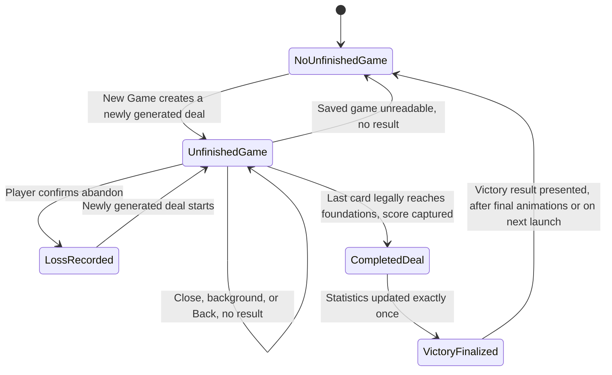
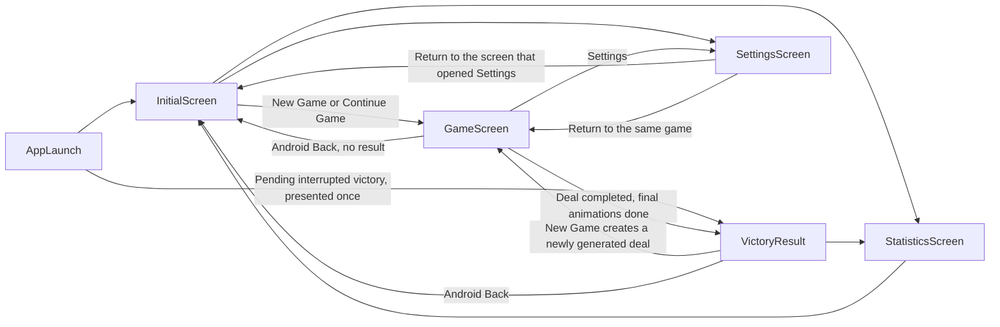

# MyFreecell Product Specification

Status: Approved
Scope: Version one

## 1. Purpose and Authority

This document is the authoritative player-facing product specification for MyFreecell. It defines product identity, scope, player-visible behavior, navigation, data boundaries, and acceptance expectations for version one.

This document does not define:

- detailed FreeCell rules, movement legality, or state-transition algorithms, which belong to the gameplay/domain specification;
- implementation technology, architecture, packages, persistence mechanisms, or code organization, which belong to the architecture phase.

Where this document references a rule owned by the gameplay/domain specification, the gameplay/domain specification governs the rule's details and this document governs the player-facing outcome.

## 2. Normative Language

- "must" identifies required version-one behavior.
- "must not" identifies prohibited version-one behavior.
- "should" identifies a deliberate recommendation.
- "may" identifies optional behavior.

Requirement identifiers (for example `LIFE-03`) are stable references for review, testing, and later specifications.

## 3. Product Identity

- **ID-01** The product name must be MyFreecell.
- **ID-02** MyFreecell must be a standalone FreeCell mobile application.
- **ID-03** MyFreecell must not be presented as part of Cringe Games or any game collection, and must not contain collection branding or collection functionality.
- **ID-04** MyFreecell must contain exactly one game: FreeCell.
- **ID-05** The product must remain simple, fast, and deliberately limited in scope. Features not specified in this document are out of scope for version one unless added by an approved revision.

## 4. Platform and Distribution

- **PLAT-01** Android is the immediate development, testing, and initial publication target.
- **PLAT-02** The intended delivery for version one is installation through the Google Play Store.
- **PLAT-03** Future Apple compatibility is intended. iOS testing and App Store publication are deferred and are not version-one acceptance criteria.
- **PLAT-04** No web application is in scope.
- **PLAT-05** Version one must present all screens in landscape orientation only. It must not present any screen in portrait orientation.
- **PLAT-06** Version one must remain in landscape orientation and should support both landscape directions so the player can rotate the phone according to preference.

## 5. Privacy and Data Boundaries

- **PRIV-01** The application must not require or offer an account.
- **PRIV-02** The application must not require or offer sign-in.
- **PRIV-03** The application must not ask for a player name or create a player profile.
- **PRIV-04** The application must not contain forms that collect personal data.
- **PRIV-05** The application must not depend on a dedicated backend service.
- **PRIV-06** The application must not provide custom cloud synchronization.
- **PRIV-07** The unfinished game, settings, and statistics must be stored locally on the device.
- **PRIV-08** The application must not claim or imply that local information is backed up or recoverable. Uninstalling the application or clearing its data can permanently remove the unfinished game, settings, and statistics.
- **PRIV-09** Version one must not contain advertising, advertising SDKs, behavioral tracking, or promotional external links.

## 6. Definitions

- **Deal**: one specific initial arrangement of the 52 cards, identified internally by a deterministic deal identity.
- **Deal identity**: an internal value that reproduces the same initial arrangement. It is never shown to the player and cannot be chosen by the player in version one.
- **Newly generated deal**: a deal produced by New Game, with a new deal identity. This specification does not require its arrangement to differ visibly from every prior arrangement.
- **Initial automatic foundation movements**: the deterministic automatic foundation transfers applied when a deal is first presented or restarted, before the player makes any move. Each counts as a move. They cannot be independently undone because no deliberate player action triggered them.
- **Unfinished game**: a deal that has been dealt to the player and has not yet received a finalized result. A deal becomes an unfinished game when it is first presented on the game screen, before the player makes any move.
- **Completed deal**: a deal in which all 52 cards have legally reached the foundations.
- **Pending victory result**: the victory result of a completed deal that has not yet been presented to the player.
- **Finalized result**: the single permanent outcome of a deal, either a victory or a loss.
- **Active play**: time during which the game screen is in the foreground showing an unfinished game, and the full Settings screen is not open. In-game decision overlays (the Restart choice and the new-game loss confirmation) are part of active play.
- **Stable point**: a game state in which no card movement, animation, or automatic movement cascade is in progress.
- **Victory finalization**: the single moment at which a completed deal is recorded as a victory, as defined in Section 12.

## 7. Game Lifecycle

### 7.1 Lifecycle outcomes

- **LIFE-01** The player must be able to start a new FreeCell deal. New Game must create a newly generated deal with a new deal identity. A new deal must begin with elapsed active-play time at zero and move count at zero before initial automatic foundation movements are applied. Each initial automatic foundation movement then counts as a move.
- **LIFE-02** There must never be more than one unfinished game.
- **LIFE-03** The player must be able to continue the unfinished game.
- **LIFE-04** The player must be able to restart the current deal from its beginning. Restarting must not record a loss or a victory.
- **LIFE-05** The player must be able to abandon an unfinished game and start a new deal. Abandoning must record exactly one loss for the abandoned deal.
- **LIFE-06** Completing a deal must produce a finalized victory.
- **LIFE-07** Each deal must produce at most one finalized result. A deal that has been finalized must never be finalized again, and a deal must never be recorded as both a victory and a loss.
- **LIFE-08** Closing the application, backgrounding the application, using Android Back from the game screen, or the operating system ending the application process must not record a loss.
- **LIFE-09** A loss must be recorded only when the player explicitly confirms abandoning an unfinished game.

### 7.2 Restart This Deal

- **LIFE-10** Restart This Deal must return the board to the same initial arrangement as the current deal, using the same deal identity.
- **LIFE-11** Restart This Deal must reset elapsed active-play time to zero and reset the move count to zero, then deterministically reapply the same initial automatic foundation movements. Each reapplied movement counts as a move. The move count immediately after restart must therefore equal the initial move count produced when the deal was first presented, and can be greater than zero.
- **LIFE-12** Restart This Deal must clear Undo and Redo history. The reapplied initial automatic foundation movements must not create undoable history.
- **LIFE-13** After an unfinished game is restored with Continue Game, Restart This Deal must still reproduce that deal's original initial arrangement and initial move count.

### 7.3 Lifecycle summary

A completed deal never returns to the unfinished-game state.

## 8. Screens and Navigation

Version one consists of the initial screen, the game screen, the victory result, the Statistics screen, and the Settings screen, plus the dialogs defined below.

No navigation path returns to the gameplay of a completed deal.

### 8.1 Initial screen

- **NAV-01** Without an unfinished game, the initial screen must offer exactly: New Game, Statistics, Settings.
- **NAV-02** With an unfinished game, the initial screen must offer exactly: Continue Game, New Game, Statistics, Settings.
- **NAV-03** Continue Game must open the game screen with the unfinished game restored.
- **NAV-04** New Game without an unfinished game must start a newly generated deal immediately, without confirmation.
- **NAV-05** New Game with an unfinished game must first show a confirmation stating that the unfinished game will count as a loss.
  - Confirming must record exactly one loss for the unfinished game and start a newly generated deal.
  - Cancelling must return to the initial screen with the unfinished game unchanged and no result recorded.
- **NAV-23** On launch, the application must open on the initial screen, except when a pending victory result must be presented as defined in WIN-11.

### 8.2 Game screen

- **NAV-06** The game screen must show a classic FreeCell board in landscape orientation with four free cells, four suit foundations, and eight tableau columns.
- **NAV-07** The game screen must have a collapsible top toolbar containing Undo, Redo, Restart, and Settings.
- **NAV-08** The toolbar must be collapsible and expandable by the player. Expanding or collapsing the toolbar must not pause the timer or change the game state.
- **NAV-09** When enabled in Settings, the timer and move count must remain visible whether the toolbar is collapsed or expanded.
- **NAV-10** Restart must open a choice with exactly three options: Restart This Deal, Start New Game, Cancel.
  - Restart This Deal must behave as defined in Section 7.2.
  - Start New Game must show a confirmation stating that the active game will count as a loss. Confirming must record exactly one loss and start a newly generated deal. Cancelling must return to the same game unchanged.
  - Cancel must return to the same game unchanged.
- **NAV-11** Settings on the toolbar must open the full Settings screen. Returning from Settings must resume the same game.

### 8.3 Statistics screen

- **NAV-12** The Statistics screen must be reachable from the initial screen and from the victory result.
- **NAV-13** Leaving the Statistics screen must return to the initial screen.

### 8.4 Settings screen

- **NAV-14** The Settings screen must be reachable from the initial screen and from the game screen.
- **NAV-15** Leaving Settings must return to the screen from which it was opened.

### 8.5 Android Back

- **NAV-16** Android Back on the initial screen must follow standard Android behavior for leaving the application.
- **NAV-17** Android Back on the game screen must save the unfinished game at a stable point, return to the initial screen, and record no result.
- **NAV-18** If Android Back is used during an automatic movement cascade or animation, the saved game must be a stable point. No card must be lost, duplicated, or left in an invalid position.
- **NAV-19** Android Back while a dialog is open must dismiss the dialog with the same effect as Cancel.
- **NAV-20** Android Back on the Settings screen must return to the screen from which Settings was opened.
- **NAV-21** Android Back on the Statistics screen must return to the initial screen.
- **NAV-22** Android Back on the victory result must return to the initial screen and must not reopen gameplay.

## 9. Player Interaction

- **PLAY-01** The player must be able to drag and drop a single card to a legal destination.
- **PLAY-02** The player must be able to drag and drop a valid multi-card sequence to a legal destination.
- **PLAY-03** A drag released over an illegal destination must return the dragged cards to their origin, leave the game state and move count unchanged, and present no gameplay message, except as defined in PLAY-10.
- **PLAY-04** A single tap on an exposed card must move that one card to an automatically selected legal destination.
- **PLAY-05** A single tap on a card with no legal destination must leave the game state unchanged, must leave the move count unchanged, and must present no gameplay message in version one.
- **PLAY-06** Cards that the gameplay/domain specification classifies as safe must move automatically to the foundations. This behavior must always be on and must have no player setting in version one.
- **PLAY-07** Card movements must be animated, including player moves, tap moves, automatic foundation moves, Undo, Redo, and the final moves before victory.
- **PLAY-08** While an automatic movement cascade is running, board input and toolbar actions that change the game must be temporarily disabled. They must become available again when the cascade completes.
- **PLAY-09** Movement legality, sequence capacity, automatic-destination priority, safe-foundation rules, move counting, and undo grouping are defined by the gameplay/domain specification and are not redefined here.
- **PLAY-10** When the player attempts to move a valid multi-card sequence whose size exceeds the current movement capacity:
  - the entire attempted sequence must first return completely to its source;
  - while the sequence is returning, board input and toolbar actions that change the game must be temporarily disabled, in the same way as defined in PLAY-08;
  - the board and move count must remain unchanged;
  - after the sequence has returned, the application must display a transient message, where M is the number of cards attempted and N is the number of empty spaces required as defined by the gameplay/domain specification:
    - when N is 1: "You need 1 empty space to move M cards." (for example, "You need 1 empty space to move 2 cards.");
    - when N is not 1: "You need N empty spaces to move M cards.";
  - the message itself must not block input;
  - the message must disappear automatically after approximately two seconds;
  - the message must not require confirmation.
- **PLAY-11** The sequence-capacity message in PLAY-10 must be the only transient invalid-movement message in version one.

## 10. Undo and Redo

- **UNDO-01** Undo and Redo must be unlimited during the current in-memory session, limited only by the available history.
- **UNDO-02** Using Undo must not invalidate a later victory. A victory reached after using Undo counts as a normal victory.
- **UNDO-03** Undo and Redo history must not be persisted after the application process ends.
- **UNDO-04** After an unfinished game is restored, Undo and Redo must begin disabled. New actions must create fresh in-memory history.
- **UNDO-05** Undo and Redo must each appear clearly disabled when no action is available to undo or redo.
- **UNDO-06** Undo and Redo must be unavailable once all 52 cards have reached the foundations, and must remain unavailable after victory finalization.
- **UNDO-07** What one Undo or Redo step contains is defined by the gameplay/domain specification.
- **UNDO-08** Initial automatic foundation movements must not be independently undoable, because no deliberate player action triggered them. Immediately after a newly generated deal is presented or Restart This Deal completes, Undo and Redo must be disabled.

## 11. Time and Moves

- **TIME-01** The timer must measure elapsed active-play time for the current deal.
- **TIME-02** The timer must pause while the application is backgrounded.
- **TIME-03** The timer must pause while the full Settings screen is open, and resume when the player returns to the game.
- **TIME-04** The timer must not pause merely because the top toolbar is expanded.
- **TIME-05** The timer must not run while the player is on the initial screen, the Statistics screen, or the victory result.
- **TIME-06** The timer must continue while the Restart choice or the new-game loss confirmation is open, because these overlays remain part of the active play session.
- **TIME-07** Turning Show Time off must hide the timer display only. Time must keep accumulating.
- **TIME-08** Turning Show Moves off must hide the move count display only. Moves must keep being counted.
- **TIME-09** Turning Show Time or Show Moves back on must show the current accumulated value.
- **TIME-10** Detailed move-count rules are defined by the gameplay/domain specification.

## 12. Victory Experience

- **WIN-01** Victory finalization must happen exactly once for each completed deal. During uninterrupted play, victory finalization and presentation of the victory result must happen after all 52 cards have legally reached the foundations and the final animations have completed. If the application is interrupted before the victory result has been presented, WIN-11 applies.
- **WIN-02** At the moment the last card legally reaches the foundations:
  - the timer must stop advancing, and that elapsed active-play time is the final time;
  - the move count at that moment is the final move count;
  - animation after that moment must not affect the final time or final move count;
  - board input, Undo, Redo, and Restart must become unavailable.
- **WIN-03** At victory finalization:
  - statistics must update exactly once using the final time and final move count;
  - the unfinished-game record must be cleared.
  The victory sound must play when the victory result is presented, if Sound is on.
- **WIN-04** After victory finalization, the player must not be able to return to interactive gameplay for the completed deal.
- **WIN-05** The victory result must show:
  - a congratulations message;
  - the final time;
  - the final move count;
  - New Game;
  - Statistics;
  - a static, local, decorative card-themed banner.
- **WIN-06** The victory result must show the final time and final move count even when Show Time or Show Moves is off.
- **WIN-07** The decorative banner must not be tappable and must not open an external destination. It must not require a network connection, an advertising SDK, an external link, or tracking.
- **WIN-08** New Game on the victory result must create a newly generated deal with a new deal identity, without a loss confirmation.
- **WIN-09** Statistics on the victory result must open the Statistics screen.
- **WIN-10** Android Back on the victory result must return to the initial screen without reopening gameplay.
- **WIN-11** If the application is interrupted after all 52 cards have legally reached the foundations but before the victory result has been presented:
  - the victory must be finalized exactly once in total, using the preserved final time and final move count, whether finalization occurred before the interruption or occurs on the next launch;
  - statistics must be updated exactly once;
  - on the next launch, the victory result must be presented exactly once;
  - the presented result must show the preserved final time and final move count and must offer New Game and Statistics, as defined in WIN-05;
  - the completed deal must not be offered through Continue Game;
  - the completed deal must never be recorded as a loss;
  - after the victory result has been presented, later launches must not present it again.

## 13. Statistics

### 13.1 Displayed statistics

The Statistics screen must show:

- **STAT-01** Victories: the number of finalized victories.
- **STAT-02** Losses: the number of finalized losses.
- **STAT-03** Success Rate: victories divided by the total of victories and losses, shown as a percentage.
- **STAT-04** Best Time: the shortest final time among victories.
- **STAT-05** Average Time: the mean final time across victories.
- **STAT-06** Fewest Moves: the lowest final move count among victories.
- **STAT-07** Average Moves: the mean final move count across victories.

### 13.2 Statistics rules

- **STAT-08** Success Rate must use finalized victories and losses only. Unfinished games must not affect it.
- **STAT-09** Time and move statistics must use victories only.
- **STAT-10** Victories and Losses must show their counts, including zero.
- **STAT-11** A statistic that cannot be calculated must show an em dash (—) instead of a misleading zero. Success Rate shows an em dash when there are no finalized results. Best Time, Average Time, Fewest Moves, and Average Moves show an em dash when there are no victories.
- **STAT-12** Time and percentage formatting must be consistent across the Statistics screen and the victory result.

### 13.3 Reset Statistics

- **STAT-13** The Statistics screen must offer Reset Statistics.
- **STAT-14** Reset Statistics must require a confirmation that states the action is irreversible.
- **STAT-15** Confirming must return all statistics to their initial state: zero victories, zero losses, and an em dash for every other statistic.
- **STAT-16** Cancelling must leave statistics unchanged.
- **STAT-17** Resetting statistics must not affect the unfinished game or settings.
- **STAT-18** If an unfinished game exists when statistics are reset, its later finalized result must be recorded in the reset statistics.

## 14. Settings

- **SET-01** Sound: on or off. It controls card-movement sounds and the victory sound. Default: on.
- **SET-02** The application must not contain music.
- **SET-03** Show Time: on or off. Default: on.
- **SET-04** Show Moves: on or off. Default: on.
- **SET-05** Background: Green, Semi-dark Blue, or Bordeaux. Default: Green.
- **SET-06** On first launch, and after application data is cleared, settings must be: Sound on, Show Time on, Show Moves on, Background Green.
- **SET-07** Settings changes must apply immediately, including to the game in progress.
- **SET-08** Settings changes must save automatically. The Settings screen must not have a Save button.
- **SET-09** Opening Settings from the game screen must pause the timer. Returning must resume the same game with the timer running again.
- **SET-10** Settings must persist across application restarts.

## 15. Persistence

- **PERS-01** Exactly one unfinished game must be saved locally, at a stable point.
- **PERS-02** Backgrounding or normally closing the application must keep the unfinished game without finalizing it.
- **PERS-03** Continue Game must restore the board, elapsed time, move count, and internal deal identity of the unfinished game.
- **PERS-04** Continue Game must not restore Undo or Redo history.
- **PERS-05** Statistics and settings must persist across application restarts.
- **PERS-06** When a victory is finalized or a loss is recorded, the stored unfinished game must be cleared or replaced so that the finalized deal can never be continued. Only the information needed to present a pending victory result under WIN-11 may be retained, and only until that result has been presented.
- **PERS-07** If a stored unfinished game cannot be restored:
  - the application must not crash;
  - the application must not record a victory or loss for that game;
  - Continue Game must not be offered for that game;
  - the application must return to the initial screen;
  - the player must receive a concise informational message that the saved game could not be recovered.
- **PERS-08** Version one must not let the player see or choose a deal number or seed.

## 16. Visual Direction

- **VIS-01** The board must be classic and immediately recognizable as FreeCell.
- **VIS-02** Controls must be modern and restrained, and must not visually dominate the board.
- **VIS-03** MyFreecell must use original visual assets. It must not copy the reference application's artwork, typography, icons, card art, gradients, or toolbar styling.
- **VIS-04** MyFreecell must not include the right-corner menu visible in reference media.
- **VIS-05** Each background choice must keep cards, free cells, foundations, controls, timer, move count, and messages clearly readable.

## 17. Language and Accessibility

- **LANG-01** All version-one user-facing text must be in English.
- **LANG-02** User-facing text should be organized so another language can be added later without major rework.
- **A11Y-01** Card rank and suit must be readable at the version-one landscape board size on supported Android phones.
- **A11Y-02** Red and black suits must be distinguishable by suit symbol and not by color alone.
- **A11Y-03** Text, cards, and controls must have sufficient contrast against each background choice.
- **A11Y-04** Disabled controls must look clearly different from enabled controls.
- **A11Y-05** Touch targets for controls and cards must be practical to use on a phone in landscape orientation.
- **A11Y-06** This specification does not claim conformance with any formal accessibility standard or certification.

## 18. Out of Scope for Version One

- Cringe Games branding or collection functionality
- Additional games
- Web application
- Portrait orientation
- Accounts, profiles, sign-in, or personal-data collection
- Backend services or custom cloud synchronization
- Cross-device continuation
- Multiplayer
- Leaderboards
- Achievements
- Social sharing
- Advertisements or advertising SDKs
- Behavioral tracking
- Music
- Exposed deal-number or seed selection
- Persisted Undo and Redo history
- Generalized card-game engine
- Speculative plugin architecture
- iOS testing and App Store publication

## 19. Deferred to the Gameplay/Domain Specification

- FreeCell rules and movement legality
- Multi-card sequence validity
- Sequence capacity calculation, including the value N in the PLAY-10 message
- Automatic destination selection and priority for single-tap moves
- Safe-foundation classification and automatic foundation movement rules
- Formalization of the approved initial automatic foundation movement behavior: deterministic reapplication at deal start and restart, counting as moves, and not being independently undoable
- Move-counting rules, including automatic moves, Undo, and Redo
- Undo and Redo grouping
- Deal generation and deterministic deal identity
- Completion detection
- Formal game-state transitions

## 20. Deferred to Architecture

- Implementation technology, frameworks, packages, and libraries
- Local storage mechanism, data format, and serialization
- State management and code organization
- Stable-point save timing and resilience against interruption
- Persistence and delivery mechanism for completed-deal information and pending victory results after interruption, including atomicity
- Corruption detection, storage recovery, and logging for stored data
- Platform backup behavior for local data
- Supported Android versions and device classes
- Orientation-handling mechanism
- Asset pipeline and string-resource organization
- Build, signing, and Play Store release process

## 21. Acceptance Expectations

Version one is accepted when all of the following can be shown on Android:

- **AC-01** First launch shows New Game, Statistics, and Settings only.
- **AC-02** Starting a deal and pressing Android Back before making any move returns to the initial screen, shows Continue Game, and records no loss.
- **AC-03** Continue Game restores the same board, elapsed time, and move count, with Undo and Redo disabled.
- **AC-04** Choosing New Game while an unfinished game exists and confirming records exactly one loss, including when the player has made no moves. Cancelling records nothing and keeps the unfinished game.
- **AC-05** Restart, then Restart This Deal, reproduces the original arrangement and resets elapsed time to zero. It resets the move count to zero before reapplying the same initial automatic foundation movements, then shows the same initial move count as when the deal was first presented. Undo and Redo are disabled afterward, and no result is recorded. This also works after Continue Game.
- **AC-06** Restart, then Start New Game, then confirming records exactly one loss and creates a newly generated deal with a new deal identity.
- **AC-07** Backgrounding the application pauses the timer. Returning resumes it. No result is recorded.
- **AC-08** Opening Settings from a game pauses the timer. Returning resumes the same game.
- **AC-09** Expanding the toolbar, opening the Restart choice, or opening the new-game loss confirmation does not pause the timer. The timer and move count stay visible when the toolbar is collapsed.
- **AC-10** With Show Time and Show Moves off, time and moves keep accumulating. Turning them on shows the current values.
- **AC-11** Dragging single cards and valid sequences, tapping cards, and automatic foundation moves all animate. Safe cards move to the foundations without player action. Input is disabled while a cascade runs.
- **AC-12** A deal completed after using Undo records exactly one victory.
- **AC-13** Completing a deal shows the victory result, after the final animations, with congratulations, final time, final moves, New Game, Statistics, and the static banner. The banner does nothing when tapped and opens no external destination.
- **AC-14** After victory, Android Back reaches the initial screen without Continue Game, and the completed deal cannot be reopened. New Game from the victory result creates a newly generated deal with a new deal identity.
- **AC-15** Statistics show em dashes for values that are not available yet, and correct values after victories and losses.
- **AC-16** Reset Statistics requires confirmation, clears statistics, and leaves the unfinished game and settings intact.
- **AC-17** On first launch, Sound, Show Time, and Show Moves are on and the background is Green. Each settings change applies immediately and persists after the application restarts.
- **AC-18** No screen requests an account, sign-in, name, or personal data. No screen shows advertising or promotional external links.
- **AC-19** No screen appears in portrait orientation.
- **AC-20** If a stored unfinished game cannot be restored, the application does not crash, shows the initial screen without Continue Game for that game, shows a concise message that the saved game could not be recovered, and leaves statistics unchanged.
- **AC-21** Attempting to move a valid sequence larger than the current movement capacity returns the entire sequence to its source and leaves the board and move count unchanged. Input is locked only while the sequence returns. Then "You need 1 empty space to move M cards." is shown when N is 1, or "You need N empty spaces to move M cards." when N is not 1. The message does not block input, disappears automatically after approximately two seconds, and requires no confirmation.
- **AC-22** Tapping a card that has no legal destination leaves the board and move count unchanged and shows no message.
- **AC-23** If the application is closed after all 52 cards legally reach the foundations but before the victory result is presented, the next launch presents the victory result exactly once. It shows the preserved final time and move count and offers New Game and Statistics. Continue Game is not offered for that deal. Statistics include that victory exactly once, with no loss recorded. A later launch does not present the result again.
- **AC-24** The final time and move count on the victory result equal the values at the moment the last card legally reached the foundations. Final animations do not change them.
